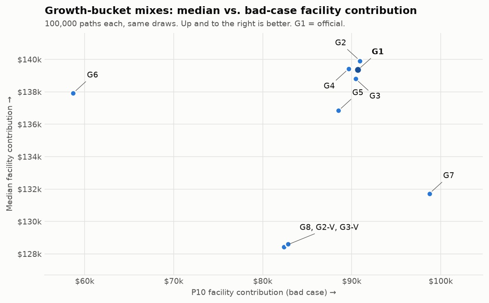

# Growth-bucket mix scenarios

100,000 paths per scenario, official seed and the same random draws in every scenario. Everything else is official: ladder, AR(1) T-bills, 1.0% top-up rule with iBonds margin, $10k backstop, glide path (1/3 to T-bills in 2031, half the rest in 2032), 75/25 facility/cushion split. Drawdowns use month-end values of the growth bucket (annual returns split into months by a Brownian bridge); "P10 outcome" = the 90th-percentile drawdown. VTI = J.P. Morgan U.S. Large Cap, VXUS = 75/25 EAFE/EM blend.

| Scenario | Facility median / P10 / P5 / worst | Bucket < $150k in Jan 2033 | Max drawdown 2028-33: median / P10 outcome | 2033 top-up not fully funded | All bills paid with / without backstop | Laura's cushion median / P10 | Co-sponsor range |
|---|---|---|---|---|---|---|---|
| G1: 60% VTI / 40% VXUS (official) | $139,362 / $90,695 / $79,795 / $18,589 | 15.7% | 17.8% / 30.0% | 0.00% (0 paths) | 100.00% (0 paths fail) / 92.77% | $46,454 / $30,232 | $90,000 - $139,000 |
| G2: 50% VTI / 50% VXUS | $139,916 / $90,923 / $79,901 / $18,162 | 15.5% | 17.8% / 30.2% | 0.00% (0 paths) | 100.00% (0 paths fail) / 92.77% | $46,639 / $30,308 | $90,000 - $139,000 |
| G3: 70% VTI / 30% VXUS | $138,801 / $90,436 / $79,451 / $19,009 | 15.9% | 17.8% / 30.1% | 0.00% (0 paths) | 100.00% (0 paths fail) / 92.77% | $46,267 / $30,145 | $90,000 - $138,000 |
| G4: 50% VTI / 30% VXUS / 20% small cap (value premium not modeled) | $139,422 / $89,643 / $78,345 / $17,685 | 16.4% | 18.4% / 31.1% | 0.00% (0 paths) | 100.00% (0 paths fail) / 92.77% | $46,474 / $29,881 | $89,000 - $139,000 |
| G5: 100% U.S. Large Cap (all-in US; a tech-heavy fund like QQQ would be more volatile than this) | $136,840 / $88,509 / $77,863 / $20,224 | 17.4% | 18.2% / 30.9% | 0.00% (0 paths) | 100.00% (0 paths fail) / 92.77% | $45,613 / $29,503 | $88,000 - $136,000 |
| G6: 100% 2x leveraged US large cap (approximation; daily reset not modeled, real decay likely worse) | $137,928 / $58,705 / $44,846 / $0 | 31.2% | 37.6% / 58.4% | 0.01% (5 paths) | 99.99% (8 paths fail) / 92.77% | $45,976 / $19,568 | $58,000 - $137,000 |
| G7: 40% VTI / 20% VXUS / 40% T-bills (cautious) | $131,721 / $98,720 / $90,806 / $46,880 | 9.5% | 10.3% / 17.0% | 0.00% (0 paths) | 100.00% (0 paths fail) / 92.77% | $43,907 / $32,907 | $98,000 - $131,000 |
| G8: 60% VTI / 40% VXUS, Vanguard pessimistic returns | $128,524 / $82,602 / $72,316 / $15,164 | 22.9% | 19.5% / 33.0% | 0.00% (0 paths) | 100.00% (0 paths fail) / 92.77% | $42,841 / $27,534 | $82,000 - $128,000 |
| G2-V: 50% VTI / 50% VXUS, Vanguard pessimistic returns | $128,427 / $82,368 / $71,986 / $14,576 | 23.2% | 19.7% / 33.3% | 0.00% (0 paths) | 100.00% (0 paths fail) / 92.77% | $42,809 / $27,456 | $82,000 - $128,000 |
| G3-V: 70% VTI / 30% VXUS, Vanguard pessimistic returns | $128,617 / $82,832 / $72,468 / $15,750 | 22.8% | 19.5% / 32.8% | 0.00% (0 paths) | 100.00% (0 paths fail) / 92.77% | $42,872 / $27,611 | $82,000 - $128,000 |

G7 has the best P10 facility contribution, $98,720 (G1: $90,695). Against G1, G5 -$2,522 at the median, -$2,186 at P10, -$1,932 at P5; G6 -$1,434 at the median, -$31,990 at P10, -$34,950 at P5. Without the backstop all bills are paid on 92.77% to 92.77% of paths (G1: 92.77%); with the backstop, bills go unpaid on 8 of 100,000 G6 paths; the growth bucket cannot fully fund the 2033 top-up on 5 G6 paths. G2 beats G1 on both median and P10 ($139,916 / $90,923 vs $139,362 / $90,695); G4 does not beat G1 on both median and P10 ($139,422 / $89,643 vs $139,362 / $90,695); under Vanguard returns, G2-V does not beat G8 ($128,427 / $82,368 vs $128,524 / $82,602); G3-V beats G8 ($128,617 / $82,832 vs $128,524 / $82,602).
